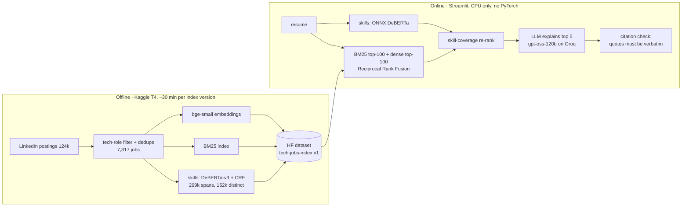

# Resume → Job Matcher

Paste a resume, get the best-matching tech jobs from **7,817 real LinkedIn postings** with the skills you have,
the ones you're missing, and **quotes from each posting as evidence**. Every quote is checked against the posting,
so the explanation can't invent requirements.

**Live demo:** TBD · **Job index:** [srish327/tech-jobs-index](https://huggingface.co/datasets/srish327/tech-jobs-index) ·
**Skill model:** [srish327/deberta-v3-skillspan-crf](https://huggingface.co/srish327/deberta-v3-skillspan-crf)
(from [project 1](https://github.com/MSR327/skillspan-ner))

[](https://github.com/MSR327/resume-job-matcher/actions/workflows/ci.yml)

## How it works



1. **Retrieve:** BM25 (exact tool names like "Terraform") and bge-small embeddings (meaning, e.g. "built ML pipelines" ≈
   "MLOps"), fused with Reciprocal Rank Fusion (k = 60).
2. **Re-rank:** `score = α · retrieval + (1 − α) · coverage`, where coverage is the share of the job's extracted skills that
   some resume skill matches (cosine ≥ τ between skill-phrase embeddings). α and τ are tuned on a dev split.
3. **Explain:** the LLM returns JSON `{fit_summary, matched_skills, missing_skills, evidence[{claim, quote}]}` for the top 5,
   in parallel. Quotes not found verbatim in the posting (after normalizing whitespace, case and typography) are dropped.
   If the LLM fails (rate limit, timeout, bad JSON) it retries once, then the app shows the ranked jobs with skill overlap only.

## Results

TBD

## Evaluation design

| Layer | Question | Method |
|---|---|---|
| L1 synthetic | Does the right job come back? | For 300 sampled jobs, an LLM (qwen3.8-27b) writes a fitting resume **in its own words** (resumes sharing >10% of 4-grams with the posting are rejected). Recall@k / MRR of the source job. Split 100 dev (tuning) / 200 test (scored once). Reposts with identical text count as the same job. |
| L2 LLM judge | Are the top 10 good matches? | gpt-oss-120b grades each (resume, job) pair 0–3 with a written rubric → nDCG@10 per configuration. The judge is a different model family from the resume writer, to limit self-preference. |
| L3 human check | Can the judge be trusted? | 50 pairs, sampled evenly across the judge's grades, labeled blind by me with the same rubric → quadratic-weighted Cohen's κ. |
| Explanations | Are they grounded? | Citation pass rate, missing-skill precision, latency and $/request through the exact app pipeline. |

CI runs an **eval gate**: the real retrieval + RRF + re-rank code on a frozen fixture (50 test queries, 2,000-job slice,
precomputed vectors, no models or network) and fails if Recall@10 or MRR drops below the recorded floor.

## Engineering notes (what broke and what it taught me)

- **Index size, 309 MB → 179 MB.** The first full build failed its own size check. Each job stored its own copy of every
  skill vector ("Python" ×2,000). Storing each of the 152k distinct phrases once, plus per-job ids, fixed it. The same
  investigation showed one-word SKILL spans ("skilled", "motivated") were noise that would have lowered every coverage
  score, so they are filtered (14% of spans).
- **Fail fast in the build notebook.** That failure came after 32 GPU-minutes and threw the result away. The notebook
  now checks the HF token and write access in its first cell, saves before any size check, and only warns on size.
- **GPU OOM on long postings.** All sentences of a 17k-character posting went through DeBERTa in one batch; fixed
  upstream in `skillex` with mini-batches trimmed to each batch's longest window.
- **No PyTorch in the app.** Both models run with ONNX Runtime: the embedder matches sentence-transformers at cosine
  1.0000, and the skill extractor agrees with PyTorch on 99.5% of spans. ONNX Runtime's constant folding turned the
  fp16-stored weights back into a full fp32 copy (+250 MB), so the app disables graph optimization (`low_memory=True`).
  The app runs in ~970 MB.
- **Hosted model retired.** The first synthetic-data run hit 404s: the Groq model in my config no longer existed, and the
  loop silently skipped every job. Now a circuit breaker stops after 15 failures in a row.
- **Typography vs. citations.** gpt-oss writes non-breaking hyphens (`end‑to‑end`), which failed exact-quote checks for
  reasons unrelated to grounding; the check normalizes them.

## Run it

```bash
pip install -r requirements.txt
echo 'GROQ_API_KEY=...' > .env      # optional: without it the app shows ranked jobs without explanations
streamlit run streamlit_app.py
```

Or with Docker: `docker build -t jobmatch . && docker run -p 8501:8501 -e GROQ_API_KEY=... jobmatch`.

Reproduce the evaluation (needs `pip install -e ".[index]" sentence-transformers` and a Groq key):

```bash
python scripts/make_synth.py --n 300     # synthetic resumes (resumable)
python scripts/eval_retrieval.py         # L1 + tuning of tau/alpha on dev
python scripts/eval_judge.py --n 30      # L2 nDCG@10 with the LLM judge
streamlit run tools/label_app.py         # L3 blind human labels, then:
python scripts/agreement.py
python scripts/eval_explain.py --n 20    # citations, missing-skill precision, latency, cost
```

## Data and privacy

- Jobs: [LinkedIn Job Postings 2023–24](https://www.kaggle.com/datasets/arshkon/linkedin-job-postings) by arshkon,
  CC BY-SA 4.0. The derived index is published under the same license ([data card](DATA_CARD.md)).
- No real resumes are stored or published. Eval resumes are synthetic. In the app, the resume is processed in memory
  and never logged; telemetry records numbers only (a test enforces that strings are rejected).

## Limitations

- Seniority is not modeled: a 2-year resume can rank "Lead" roles highly.
- Skill spans from job postings are long and fuzzy (skill F1 ~0.56 for the extractor), so coverage is a rough signal.
- Synthetic resumes are cleaner than real ones; L1 numbers are an upper-bound-ish sanity check, which is why L2/L3 exist.
- The corpus is a 2023–24 snapshot, US-centric, tech roles only.

## Repo map

| Path | What |
|---|---|
| `src/jobmatch/` | corpus filter, index, retrieval, re-rank, LLM client, explanations, judge, metrics, telemetry, ONNX embedder, pipeline |
| `streamlit_app.py`, `pages/` | app + Stats page |
| `notebooks/01_build_index.ipynb` | Kaggle build of the index |
| `scripts/` | eval scripts, smoke test, CI fixture builder, parity checks |
| `tools/label_app.py` | blind labeling UI |
| `tests/` | unit tests + eval gate (no network) |
